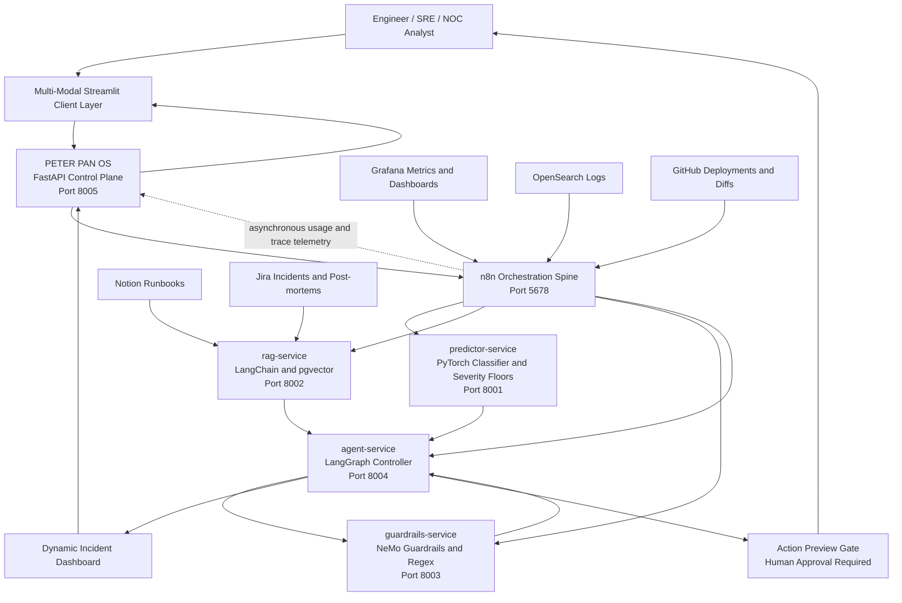

# PETER PAN - Predictive, Agentic Navigator

[](LICENSE)
[](https://www.python.org/)
[](https://github.com/langchain-ai/langgraph)
[](https://n8n.io/)
[](https://www.docker.com/)

> **From fragmented telemetry to an evidence-backed incident story.**

During an active infrastructure incident, critical intelligence is scattered across disconnected systems: metrics in Grafana, logs in OpenSearch, deployment changes in GitHub, runbooks in Notion, and post-incident records in Jira. Under downtime pressure, engineers lose valuable time manually correlating these signals.

**PETER PAN** is an asynchronous incident-intelligence platform designed to reduce **Mean Time to Resolution (MTTR)**. It correlates:

`Metrics ↔ Logs ↔ Deployments ↔ Runbooks ↔ Past Incidents`

The resulting **Dynamic Incident Dashboard** creates an immutable incident snapshot: a structured timeline, the highest-probability root-cause hypothesis, evidence and citation trails, confidence indicators, targeted remediation options, and explicit human approval controls for any potentially mutating action.

PETER PAN is not a Grafana replacement or a thin Grafana wrapper. Grafana remains the observability substrate. PETER PAN adds an intelligence and orchestration layer that enriches alerts, explains likely causes, captures analyst feedback, and generates incident-focused dashboards dynamically.

> **Zero-autonomy infrastructure safety:** PETER PAN never executes infrastructure mutations autonomously. Every remediation proposal passes through an immutable **Action Preview Gate** and requires explicit, audited human authorization before execution.

---

## Table of Contents

- [Implementation Status](#implementation-status)
- [Core Capabilities](#core-capabilities)
- [Architecture](#architecture)
- [Engineering Invariants](#engineering-invariants)
- [Environment Matrix](#environment-matrix)
- [Quickstart](#quickstart)
- [Documentation Map](#documentation-map)
- [License](#license)

---

## Implementation Status

This README describes the full target architecture. The table below maps each
component to what is actually implemented today, so the docs never overstate
the code. The MVP is **fixture-first by design**: every path runs with zero
external accounts; live backends are opt-in upgrades behind existing
interfaces (`predict()`, `search()`, `check_*()`, `build_story()`).

| Component | Status | What exists today | Live upgrade path |
|---|---|---|---|
| `predictor` (8001) | ✅ Floor + local model | Keyword/severity floor in `services/predictor.py` with final say; opt-in PyTorch bag-of-words classifier (`PP_PREDICTOR=torch`, `ml` extra) refines unclassified alerts and may raise severity, never lower it | Train on verified-incident feedback (offline loop) |
| `rag` (8002) | ✅ Two backends | Lexical retrieval over `knowledge/` (default); Pinecone + Voyage semantic backend (`PP_RAG_BACKEND=pinecone`), falls back to lexical on failure | RDS Postgres + pgvector (target) |
| `guardrails` (8003) | ✅ Regex floor | Deterministic input/output rails in `services/guardrails.py`; floor always wins | NeMo Guardrails layered on top (planned) |
| `agent` (8004) | ✅ Deterministic + opt-in LLM | `build_story()` deterministic by default; `PP_LLM=anthropic` enables Claude synthesis with citation/contradiction/confidence guards; LangGraph graph mirrors the same contract | LLM planner nodes inside the graph (planned) |
| PETER PAN OS (8005) | ✅ MVP+ | Usage metering via `peterpan.usage`; `/os/usage` with time windows (`?hours=`) and grouping (`?by=agent\|model\|service`); `/os/usage/series` — bucketed cost/token time series; `/os/budget` — deterministic daily-spend guard (`PP_DAILY_BUDGET_USD`, ok/warn/exceeded, report-only); `/os/agents`, `/os/tips`; `/os/services` — server-side mesh healthz sweep (`PP_MESH`); operator console: `web/agent-os` React app (token/cost dashboard, agents, services, budget; demo-data fallback) | Budget enforcement + routing analytics (planned) |
| Streamlit UI | ✅ MVP | Incident dashboard + dynamic LLM-designed panels (`dashboard.py`) | — |
| n8n spine | ✅ Live | `PETER PAN — Triage v2` active: webhook → input rail → LLM story → output rail → respond, wired to the EC2 mesh; SG allowlists the n8n egress IP | Self-hosted n8n in compose (target) |
| AWS deploy | ✅ Live | `infra/aws/stack.yaml` — EC2 mesh with `PP_LLM=anthropic` + `PP_RAG_BACKEND=pinecone`, keys from Secrets Manager (per-service least privilege), shared usage log for PETER PAN OS | Private subnet + tunnel hardening (target) |
| Prompt versioning + evals | ✅ Active | `prompts/versions.yaml`, per-surface LOG, deterministic story eval + LLM-judge (`evals/`) | Ragas metrics + Langfuse tracing (planned) |
| Offline training loop | 🔜 Planned | Verified-incident dataset export design | PyTorch training pipeline |

---

## Core Capabilities

1. **Alert enrichment** — a raw alert is correlated with metrics and anomaly signals, relevant logs, recent deployments, service ownership, runbooks, and similar historical incidents: not just *that* it fired, but *why* it may have fired and what evidence supports that conclusion.
2. **Dynamic incident dashboards** — instead of hundreds of static dashboards, a focused incident view is generated for the problem currently being investigated: timeline, correlated evidence, deployment deltas, root-cause hypotheses with confidence values, and remediation previews.
3. **Human feedback and continuous learning** — engineers approve, reject, or correct generated conclusions; feedback is tied to the original trace and feeds evaluation datasets, prompt/retrieval regression tests, classifier improvement, and confidence calibration.

Business value targets (MTTR reduction, triage speed, LLM cost control) live in [docs/ROADMAP.md](docs/ROADMAP.md).

---

## Architecture

PETER PAN uses an isolated mesh of specialized services connected through an **n8n orchestration spine**. Conversational and tool-based reasoning is controlled by a bounded, stateful **LangGraph** pipeline to prevent uncontrolled execution loops.



The incident-processing sequence diagram, the per-service API grid, and the MVP-to-target mapping live in [docs/ARCHITECTURE.md](docs/ARCHITECTURE.md).

---

## Engineering Invariants

The following safeguards are deterministic system rules. They are intended to be verified continuously through automated tests and CI checks.

1. **Immutable citation trail**  
   Every informational claim shown on the dashboard must map to an authenticated evidence reference. Claims without valid source mappings fail output validation and are removed.

2. **Action Preview Gate**  
   Every infrastructure-mutating proposal requires explicit, named human approval. Production mutations are blocked at the code interface until a valid approval record is present.

3. **Deterministic floor overrides**  
   Guardrail regular expressions and the predictor service's severity floor retain final veto authority. An LLM may enrich the explanation, but it cannot weaken deterministic safety boundaries.

4. **Capped confidence values**  
   Incident probabilities and confidence values are always capped below `1.0`. The platform does not represent uncertain conclusions as absolute facts.

5. **Bounded execution budgets**  
   Every LangGraph execution has a finite step and token budget. Budget exhaustion triggers circuit breaking and a deterministic fallback path instead of an uncontrolled loop.

6. **Asynchronous usage metering**  
   API usage is recorded through `peterpan.usage.log_usage`. Metrics are buffered in a thread-safe local queue and flushed asynchronously to PETER PAN OS so telemetry does not block incident processing.

7. **Read-only production default**  
   Production integrations are treated as read-only unless an explicitly authorized execution path is enabled. No autonomous repair command is permitted.

---

## Environment Matrix

Runtime behavior is isolated through the `PP_ENV` environment variable.

| `PP_ENV` Mode | Context | External Integrations | Mutation Policy | Intended Use |
|---|---|---|---|---|
| `mirage` | Local static fixtures | Disabled or mocked | Mock actions only | Local development, demonstrations, deterministic E2E tests, and zero-cost execution. |
| `staging` | Synthetic data overlays | Real routing may be enabled | Explicit local approval required | Integration testing and controlled pre-production validation. |
| `production` | Live production context | Read-only integrations by default | Human-in-the-loop key unlock and audited approval required | Enterprise deployment target. |

For development and demonstrations, use `PP_ENV=mirage` unless a test explicitly requires another mode.

---

## Quickstart

```bash
git clone https://github.com/reem-mor/peter-pan.git
cd peter-pan
export PP_ENV=mirage        # PowerShell: $env:PP_ENV = "mirage"
docker compose up --build   # service mesh on ports 8001-8005
```

Then open a surface:

```bash
python -m streamlit run ui/app.py   # incident UI  -> http://localhost:8501
cd web/agent-os && npm install && npm run dev   # operator console (proxies :8005)
```

Verify health: `curl http://localhost:800{1..5}/healthz`. Run tests: `python -m pytest -q`.

Full walkthrough (prerequisites, n8n panel, PowerShell equivalents, teardown, AWS target): [docs/DEPLOYMENT.md](docs/DEPLOYMENT.md).

---

## Documentation Map

| Document | Contents |
|---|---|
| [docs/ARCHITECTURE.md](docs/ARCHITECTURE.md) | Runtime flow, incident-processing sequence, microservice grid and API mapping, MVP-to-target swap order |
| [docs/DEPLOYMENT.md](docs/DEPLOYMENT.md) | Full local deployment walkthrough and the hardened AWS target (network, IAM, storage) |
| [docs/TESTING.md](docs/TESTING.md) | Test-suite setup and the evaluation infrastructure layers |
| [docs/MONITORING.md](docs/MONITORING.md) | Closed-loop LLMOps lifecycle: Langfuse tracing, Ragas evaluation, classifier learning loop |
| [docs/ROADMAP.md](docs/ROADMAP.md) | Business value targets, reference baselines, evolution roadmap |
| [docs/CONTRACTS.md](docs/CONTRACTS.md) | Service request/response contracts |
| [docs/DOMAINS.md](docs/DOMAINS.md) | Domain model and vocabulary |
| [docs/adr/](docs/adr/) | Architecture decision records |

---

## Safety Notice

PETER PAN is an incident-analysis and decision-support system. Generated hypotheses and remediation previews must be reviewed by qualified operators. The platform must not be configured to perform autonomous production mutations without explicit authorization, policy enforcement, audit logging, and organization-specific security review.

---

## License

This repository is licensed under the [MIT License](LICENSE).
