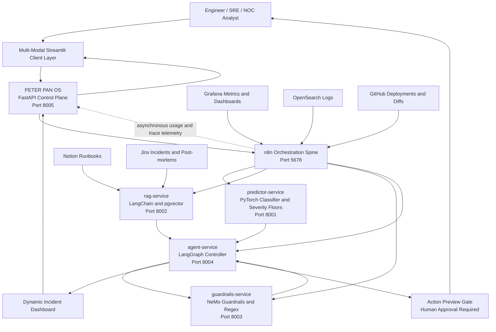
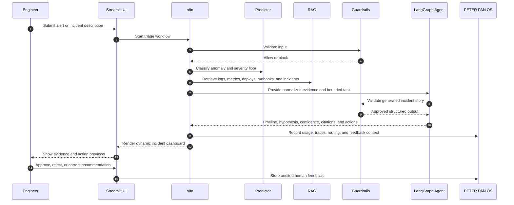
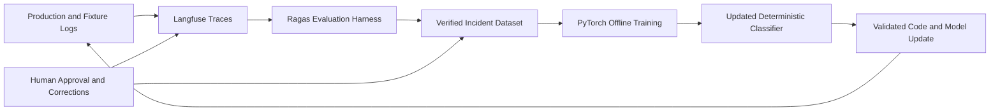
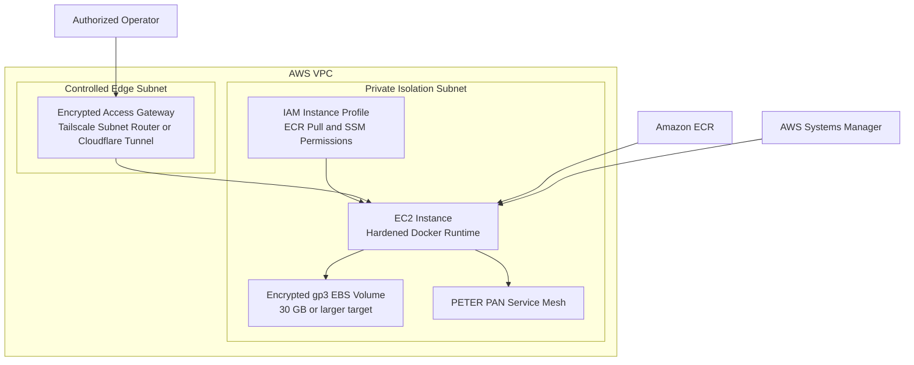

# PETER PAN - Predictive, Agentic Navigator

[](LICENSE)
[](https://www.python.org/)
[](https://github.com/langchain-ai/langgraph)
[](https://n8n.io/)
[](https://www.docker.com/)

> **From fragmented telemetry to an evidence-backed incident story.**

During an active infrastructure incident, critical intelligence is scattered across disconnected systems: metrics in Grafana, logs in OpenSearch, deployment changes in GitHub, runbooks in Notion, and post-incident records in Jira. Under downtime pressure, engineers lose valuable time manually correlating these signals.

**PETER PAN** is an asynchronous incident-intelligence platform designed to reduce **Mean Time to Resolution (MTTR)**. It correlates:

`Metrics ↔ Logs ↔ Deployments ↔ Runbooks ↔ Past Incidents`

The resulting **Dynamic Incident Dashboard** creates an immutable incident snapshot that presents:

- A structured incident timeline
- The highest-probability root-cause hypothesis
- Evidence and citation trails
- Confidence indicators
- Targeted remediation options
- Explicit human approval controls for any potentially mutating action

PETER PAN is not a Grafana replacement or a thin Grafana wrapper. Grafana remains the observability substrate. PETER PAN adds an intelligence and orchestration layer that enriches alerts, explains likely causes, captures analyst feedback, and generates incident-focused dashboards dynamically.

> **Zero-autonomy infrastructure safety:** PETER PAN never executes infrastructure mutations autonomously. Every remediation proposal passes through an immutable **Action Preview Gate** and requires explicit, audited human authorization before execution.

---

## Table of Contents

- [Implementation Status](#implementation-status)
- [Core Capabilities](#core-capabilities)
- [Business Value and Efficiency Targets](#business-value-and-efficiency-targets)
- [Architecture](#architecture)
- [Microservice Grid and API Mapping](#microservice-grid-and-api-mapping)
- [Engineering Invariants](#engineering-invariants)
- [Environment Matrix](#environment-matrix)
- [Monitoring, Evaluation, and Learning Loop](#monitoring-evaluation-and-learning-loop)
- [Testing and Evaluation](#testing-and-evaluation)
- [Local Deployment](#local-deployment)
- [Enterprise AWS Deployment Target](#enterprise-aws-deployment-target)
- [Evolution Roadmap and Reference Baselines](#evolution-roadmap-and-reference-baselines)
- [License](#license)

---

## Implementation Status

This README describes the full target architecture. The table below maps each
component to what is actually implemented today, so the docs never overstate
the code. The MVP is **fixture-first by design**: every path runs with zero
external accounts; live backends are opt-in upgrades behind existing
interfaces (`predict()`, `search()`, `check_*()`, `build_story()`).

| Component | Status | What exists today | Live upgrade path |
|---|---|---|---|
| `predictor` (8001) | ✅ Floor + local model | Keyword/severity floor in `services/predictor.py` with final say; opt-in PyTorch bag-of-words classifier (`PP_PREDICTOR=torch`, `ml` extra) refines unclassified alerts and may raise severity, never lower it | Train on verified-incident feedback (offline loop) |
| `rag` (8002) | ✅ Two backends | Lexical retrieval over `knowledge/` (default); Pinecone + Voyage semantic backend (`PP_RAG_BACKEND=pinecone`), falls back to lexical on failure | RDS Postgres + pgvector (target) |
| `guardrails` (8003) | ✅ Regex floor | Deterministic input/output rails in `services/guardrails.py`; floor always wins | NeMo Guardrails layered on top (planned) |
| `agent` (8004) | ✅ Deterministic + opt-in LLM | `build_story()` deterministic by default; `PP_LLM=anthropic` enables Claude synthesis with citation/contradiction/confidence guards; LangGraph graph mirrors the same contract | LLM planner nodes inside the graph (planned) |
| PETER PAN OS (8005) | ✅ MVP+ | Usage metering via `peterpan.usage`; `/os/usage` with time windows (`?hours=`) and grouping (`?by=agent\|model\|service`); `/os/budget` — deterministic daily-spend guard (`PP_DAILY_BUDGET_USD`, ok/warn/exceeded, report-only); `/os/agents`, `/os/tips` | Budget enforcement + routing analytics (planned) |
| Streamlit UI | ✅ MVP | Incident dashboard + dynamic LLM-designed panels (`dashboard.py`) | — |
| n8n spine | ✅ Live | `PETER PAN — Triage v2` active: webhook → input rail → LLM story → output rail → respond, wired to the EC2 mesh; SG allowlists the n8n egress IP | Self-hosted n8n in compose (target) |
| AWS deploy | ✅ Live | `infra/aws/stack.yaml` — EC2 mesh with `PP_LLM=anthropic` + `PP_RAG_BACKEND=pinecone`, keys from Secrets Manager (per-service least privilege), shared usage log for PETER PAN OS | Private subnet + tunnel hardening (target) |
| Prompt versioning + evals | ✅ Active | `prompts/versions.yaml`, per-surface LOG, deterministic story eval + LLM-judge (`evals/`) | Ragas metrics + Langfuse tracing (planned) |
| Offline training loop | 🔜 Planned | Verified-incident dataset export design | PyTorch training pipeline |

---

## Core Capabilities

### 1. Alert Enrichment

PETER PAN receives a raw alert and correlates it with observability and operational context, including:

- Metrics and anomaly signals
- Relevant logs
- Recent deployments and configuration changes
- Service ownership and system context
- Runbooks
- Similar historical incidents

The result explains not only that an alert fired, but also why it may have fired and what evidence supports that conclusion.

### 2. Dynamic Incident Dashboards

Instead of maintaining hundreds of static dashboards, PETER PAN generates a focused incident view for the problem currently being investigated. The generated dashboard can include:

- Incident-specific Grafana panels
- A normalized incident timeline
- Correlated metrics and logs
- Deployment deltas
- Root-cause hypotheses
- Confidence values
- Evidence references
- Remediation previews

### 3. Human Feedback and Continuous Learning

Engineers can approve, reject, or correct generated conclusions and remediation proposals. This feedback is tied to the original trace and can later support:

- Evaluation datasets
- Prompt and retrieval regression testing
- Classifier improvement
- Offline model training
- Better routing and confidence calibration

---

## Business Value and Efficiency Targets

PETER PAN is designed for production operations, NOC, DevOps, SRE, and platform engineering teams that require reliability, safety, and cost control.

| Value Area | Intended Impact |
|---|---|
| **MTTR reduction** | Reduce root-cause isolation time by automating cross-system correlation and presenting a single evidence-backed incident story. |
| **Faster triage** | Replace manual switching between dashboards, logs, deployment history, runbooks, and tickets with one guided workflow. |
| **LLM cost control** | Use local semantic routing, context compression, deterministic caching, and bounded execution to reduce unnecessary commercial-model calls. Selected workloads target cost reductions of up to **70x** compared with naive RAG pipelines. |
| **Lower hallucination risk** | Require citations, deterministic validation, severity floors, confidence caps, and output guardrails before content reaches the incident dashboard. |
| **Safer remediation** | Keep production mutations behind explicit human approval and audit records. |
| **Reusable operational knowledge** | Convert analyst decisions and resolved incidents into traceable evaluation and training data. |

The stated performance and cost values are engineering targets that should be validated against controlled benchmarks before being treated as production guarantees.

---

## Architecture

PETER PAN uses an isolated mesh of specialized services connected through an **n8n orchestration spine**. Conversational and tool-based reasoning is controlled by a bounded, stateful **LangGraph** pipeline to prevent uncontrolled execution loops.



### Incident Processing Flow



---

## Microservice Grid and API Mapping

| Service | Port | Core Technology | Primary Endpoints | Responsibility |
|---|---:|---|---|---|
| `predictor` | `8001` | PyTorch and deterministic keyword floors | `GET /healthz`, `POST /predict` | Classifies anomaly vectors and enforces minimum severity boundaries. |
| `rag` | `8002` | LangChain and AWS RDS for PostgreSQL with pgvector | `GET /healthz`, `POST /query` | Retrieves and aggregates codebase maps, logs, runbooks, deployment context, and historical incidents. |
| `guardrails` | `8003` | NeMo Guardrails and deterministic regular expressions | `GET /healthz`, `POST /check/input`, `POST /check/output` | Validates input patterns, output structure, and safety thresholds. |
| `agent` | `8004` | LangGraph stateful planner | `GET /healthz`, `POST /story` | Coordinates bounded tool-use, planning, evidence synthesis, and incident-story generation. |
| `PETER PAN OS` | `8005` | FastAPI and a thread-safe queue | `GET /healthz`, `GET /os/usage`, `GET /os/agents`, `GET /os/tips` | Provides the operational control plane for cost, token, agent, routing, and usage visibility. |

---

## Engineering Invariants

The following safeguards are deterministic system rules. They are intended to be verified continuously through automated tests and CI checks.

1. **Immutable citation trail**  
   Every informational claim shown on the dashboard must map to an authenticated evidence reference. Claims without valid source mappings fail output validation and are removed.

2. **Action Preview Gate**  
   Every infrastructure-mutating proposal requires explicit, named human approval. Production mutations are blocked at the code interface until a valid approval record is present.

3. **Deterministic floor overrides**  
   Guardrail regular expressions and the predictor service's severity floor retain final veto authority. An LLM may enrich the explanation, but it cannot weaken deterministic safety boundaries.

4. **Capped confidence values**  
   Incident probabilities and confidence values are always capped below `1.0`. The platform does not represent uncertain conclusions as absolute facts.

5. **Bounded execution budgets**  
   Every LangGraph execution has a finite step and token budget. Budget exhaustion triggers circuit breaking and a deterministic fallback path instead of an uncontrolled loop.

6. **Asynchronous usage metering**  
   API usage is recorded through `peterpan.usage.log_usage`. Metrics are buffered in a thread-safe local queue and flushed asynchronously to PETER PAN OS so telemetry does not block incident processing.

7. **Read-only production default**  
   Production integrations are treated as read-only unless an explicitly authorized execution path is enabled. No autonomous repair command is permitted.

---

## Environment Matrix

Runtime behavior is isolated through the `PP_ENV` environment variable.

| `PP_ENV` Mode | Context | External Integrations | Mutation Policy | Intended Use |
|---|---|---|---|---|
| `mirage` | Local static fixtures | Disabled or mocked | Mock actions only | Local development, demonstrations, deterministic E2E tests, and zero-cost execution. |
| `staging` | Synthetic data overlays | Real routing may be enabled | Explicit local approval required | Integration testing and controlled pre-production validation. |
| `production` | Live production context | Read-only integrations by default | Human-in-the-loop key unlock and audited approval required | Enterprise deployment target. |

For development and demonstrations, use `PP_ENV=mirage` unless a test explicitly requires another mode.

---

## Monitoring, Evaluation, and Learning Loop

PETER PAN implements a closed-loop LLMOps lifecycle across three operational layers:

1. Observability and trace collection
2. Automated retrieval and generation evaluation
3. Offline classifier improvement



### 1. Real-Time Observability and Production Monitoring with Langfuse

Agent steps, tool invocations, prompt versions, model calls, and retrieval chunks are traced through an asynchronous and non-blocking observability path.

- **Trace analytics:** LangGraph execution steps are recorded as linked spans so routing bottlenecks, latency, tool failures, and context growth can be investigated. Configured anomaly and latency thresholds can alert the platform engineering team.
- **Cost and token attribution:** Commercial and local-model usage can be attributed to a specific incident, workflow, agent, and service.
- **Human feedback capture:** Approval, rejection, and correction events from the Action Preview Gate are attached to the relevant trace identifier.
- **Operational dataset creation:** Verified feedback creates higher-quality examples for later evaluation and offline learning.

### 2. Automated Regression and Quality Evaluation with Ragas

Prompt changes, retrieval changes, and agent-logic changes are evaluated with software-engineering discipline through a headless Ragas harness. Changes to versioned prompts or the RAG ingestion path can trigger this regression suite automatically in CI/CD.

- **Faithfulness:** Checks whether generated incident conclusions remain grounded in retrieved metrics, logs, and operational evidence.
- **Answer relevance:** Checks whether remediation options directly address the observed incident rather than adding irrelevant text.
- **Context recall:** Measures whether the retriever finds the runbooks, configurations, deployment diffs, and historical incidents needed to answer correctly.
- **Context precision:** Measures whether retrieved evidence is relevant instead of introducing unnecessary context.

### 3. PyTorch Deterministic Classifier Floor

The `predictor` service on port `8001` runs a lightweight local PyTorch classifier.

- **The guard:** It evaluates incoming alert signals and establishes a minimum mathematical severity level, such as Severity 1 through Severity 4.
- **The override:** Deterministic severity rules can raise the minimum result when critical patterns are detected.
- **The learning loop:** Verified incidents and human corrections can be exported into an offline training pipeline. Candidate classifier updates are evaluated before validated versions are deployed back into the service.
- **The cost benefit:** Better local classification reduces unnecessary dependence on commercial models for basic routing and severity decisions.

---

## Testing and Evaluation

PETER PAN uses a layered test strategy for services, contracts, workflows, guardrails, prompts, retrieval, and agent execution.

### Create the Virtual Environment

```bash
python -m venv .venv
```

Activate it on Linux or macOS:

```bash
source .venv/bin/activate
```

Activate it on Windows PowerShell:

```powershell
.\.venv\Scripts\Activate.ps1
```

### Install Development and UI Dependencies

```bash
python -m pip install --upgrade pip
pip install -e ".[dev,ui]"
```

### Run the Test Suite

```bash
python -m pytest -v
```

### Evaluation Infrastructure

The evaluation layer is organized around the following responsibilities:

- **`prompts/`** - Versioned system instructions and prompt templates, separated from application logic.
- **`data/`** - Recorded or synthetic historical incident fixtures used for deterministic tests.
- **`evals/`** - Ragas evaluations, prompt regressions, retrieval checks, and quality thresholds.
- **Agent graph validation** - Ensures tools are selected correctly and execution cannot enter infinite iterative states.
- **Contract validation** - Ensures all services exchange stable, schema-valid request and response objects.
- **Safety validation** - Confirms that mutation attempts, unsupported confidence values, uncited claims, and unsafe inputs are blocked.

---

## Local Deployment

### Prerequisites

- Python `3.12` or newer
- Docker Engine or Docker Desktop
- Docker Compose v2
- Git
- Sufficient local memory for the selected model and vector-store configuration

### 1. Clone the Repository

```bash
git clone https://github.com/reem-mor/peter-pan.git
cd peter-pan
```

### 2. Select the Safe Local Environment

Linux or macOS:

```bash
export PP_ENV=mirage
```

Windows PowerShell:

```powershell
$env:PP_ENV = "mirage"
```

### 3. Start the Service Mesh

```bash
docker compose up --build
```

This starts the core service mesh and its required dependencies according to the repository's Compose configuration.

### 4. Start the Streamlit Interface

```bash
python -m streamlit run ui/app.py
```

Streamlit normally opens at:

```text
http://localhost:8501
```

### 5. Open the n8n Orchestration Panel

```text
http://localhost:5678
```

Use n8n to inspect the active JSON routing workflow between the user interface, control plane, and microservices.

### 6. Verify Service Health

```bash
curl http://localhost:8001/healthz
curl http://localhost:8002/healthz
curl http://localhost:8003/healthz
curl http://localhost:8004/healthz
curl http://localhost:8005/healthz
```

On Windows PowerShell, `Invoke-RestMethod` can be used instead:

```powershell
Invoke-RestMethod http://localhost:8001/healthz
Invoke-RestMethod http://localhost:8002/healthz
Invoke-RestMethod http://localhost:8003/healthz
Invoke-RestMethod http://localhost:8004/healthz
Invoke-RestMethod http://localhost:8005/healthz
```

### Stop the Stack

```bash
docker compose down
```

To remove local volumes as well:

```bash
docker compose down -v
```

Use the volume-removal command only when you intentionally want to delete local persisted data.

---

## Enterprise AWS Deployment Target

PETER PAN is designed to support a hardened AWS deployment through infrastructure definitions in `infra/aws/`, including AWS CloudFormation.



### Network Perimeter Hardening

- Compute workloads run inside a private subnet.
- Unrestricted inbound rules such as `0.0.0.0/0` are prohibited.
- Administrative access is brokered through an encrypted Tailscale subnet router, Cloudflare Tunnel, or another explicitly approved private-access mechanism.
- Direct public exposure of internal service ports is not part of the target architecture.

### AWS IAM Least Privilege

- EC2 uses an IAM instance profile rather than long-lived static credentials.
- ECR permissions are limited to the actions required to pull approved images.
- SSM permissions are scoped to controlled instance management.
- AWS mutation permissions are separated from normal read-only incident analysis.
- Every allowed API action should be traceable to a specific IAM policy statement.

### Storage Baseline

- Use encrypted `gp3` EBS volumes.
- A baseline of at least `30 GB` is recommended for container layers, logs, vector data, and local caches.
- Application data, logs, and vector-store data should be isolated from disposable container layers where practical.

---

## Evolution Roadmap and Reference Baselines

PETER PAN evaluates established incident-management and agentic-observability products for architectural and user-experience lessons while maintaining an independent implementation.

| Reference | Relevant Design Area |
|---|---|
| `resolve.ai` | Incident context, investigation workflow, and operational intelligence patterns |
| `incident.io` | Incident timeline, collaboration, and responder experience patterns |
| `HolmesGPT` | Open-source observability investigation and telemetry-mapping concepts |

Detailed transformation matrices and production-readiness plans should be maintained under `docs/`. These may include transitions such as:

- Static fixtures to authenticated production integrations
- Keyword-based floors to validated fine-tuned classifiers
- Local vector storage to managed PostgreSQL with pgvector
- Single-node demonstration deployment to resilient multi-node architecture
- Offline evaluation datasets to continuous trace-based regression suites
- Preview-only remediation to audited and policy-controlled execution adapters

---

## Safety Notice

PETER PAN is an incident-analysis and decision-support system. Generated hypotheses and remediation previews must be reviewed by qualified operators. The platform must not be configured to perform autonomous production mutations without explicit authorization, policy enforcement, audit logging, and organization-specific security review.

---

## License

This repository is licensed under the [MIT License](LICENSE).
