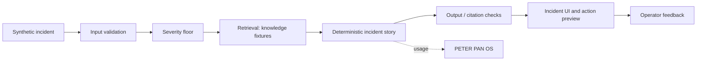
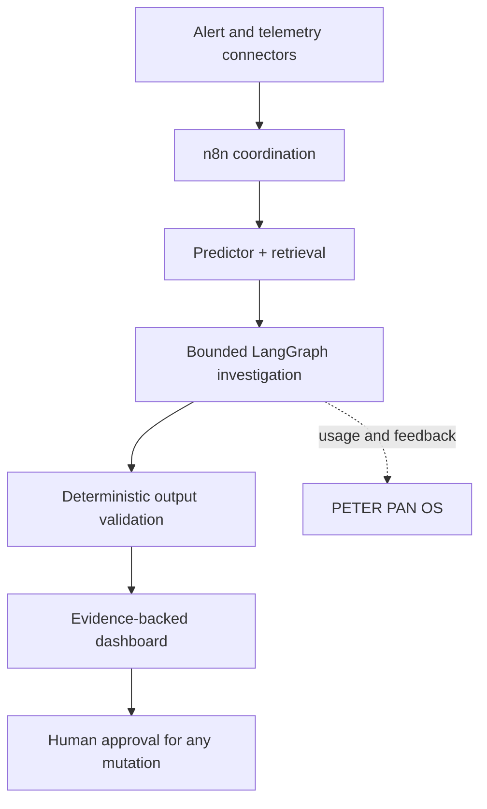

# Architecture: implemented vs target

> **Read this first:** The system is fixture-first for reproducibility. The [main README](../README.md#implementation-status) is the authoritative implementation-status matrix. This document distinguishes the tested default path from optional integrations and future architecture.

## Default local path (implemented)

The repository includes FastAPI services for predictor (8001), RAG (8002), guardrails (8003), agent/story building (8004), and PETER PAN OS (8005). Docker Compose builds and exercises these services in CI. The default local environment uses fixtures without external API keys.

## Implemented opt-in paths

- **Retrieval:** lexical `knowledge/` lookup by default; Pinecone + Voyage semantic retrieval when configured, with fallback.
- **Agent:** deterministic story builder by default; Anthropic synthesis and bounded LangGraph path when enabled and configured.
- **Predictor:** deterministic keyword/severity policy by default; optional PyTorch classifier on the ML extra.
- **Orchestration and infrastructure:** versioned n8n cloud flow, AWS EC2/CloudFormation configuration and secrets integration are described in deployment documentation. Their operational availability is separate from the fixture-first test guarantee.
- **Operator experience:** Streamlit dashboard and React PETER PAN OS console; some views can use demo data.

## Target architecture (not the default implementation)

Planned improvements include robust authenticated production connectors, managed PostgreSQL/pgvector retrieval, NeMo guardrails layered on existing deterministic policies, richer traces/evaluations, and a hardened deployment network. Do not interpret the target diagram as proof that every component is live.

## Service contracts and test evidence

| Service | Port | Default implementation | Relevant routes |
|---|---:|---|---|
| Predictor | 8001 | Keyword/severity floor; opt-in ML | `/healthz`, `/predict` |
| Retrieval | 8002 | Lexical corpus; opt-in Pinecone | `/healthz`, `/query` |
| Guardrails | 8003 | Deterministic input/output validation | `/healthz`, `/check/input`, `/check/output` |
| Agent | 8004 | Deterministic incident story; opt-in LLM/graph | `/healthz`, `/story` |
| PETER PAN OS | 8005 | Local usage/health control plane | `/healthz`, `/os/usage`, `/os/budget`, `/os/services` |

For exact schemas, consult [CONTRACTS.md](CONTRACTS.md). For run commands and evaluation boundaries, consult [TESTING.md](TESTING.md). For production deployment targets, consult [DEPLOYMENT.md](DEPLOYMENT.md).

## Safety boundaries

The design uses read-only defaults, deterministic policy vetoes, capped confidence, bounded agent execution, citations, and human-reviewed action previews. These are engineering controls, **not** a claim of independent production security certification or demonstrated MTTR improvement. Compare implemented tests and user paths with planned guardrails before describing a feature as production-ready.
