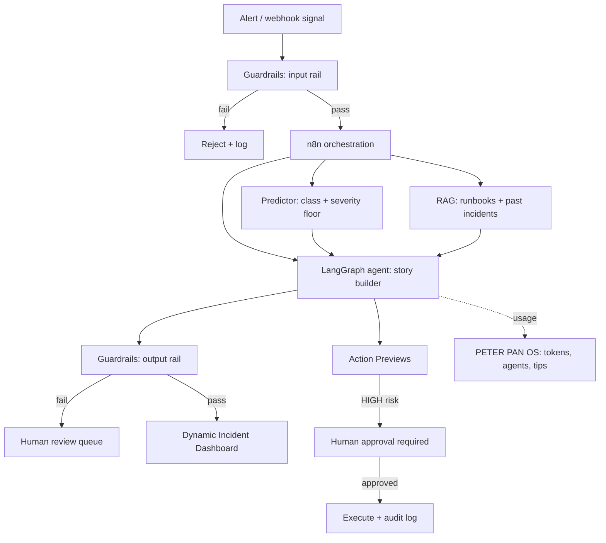
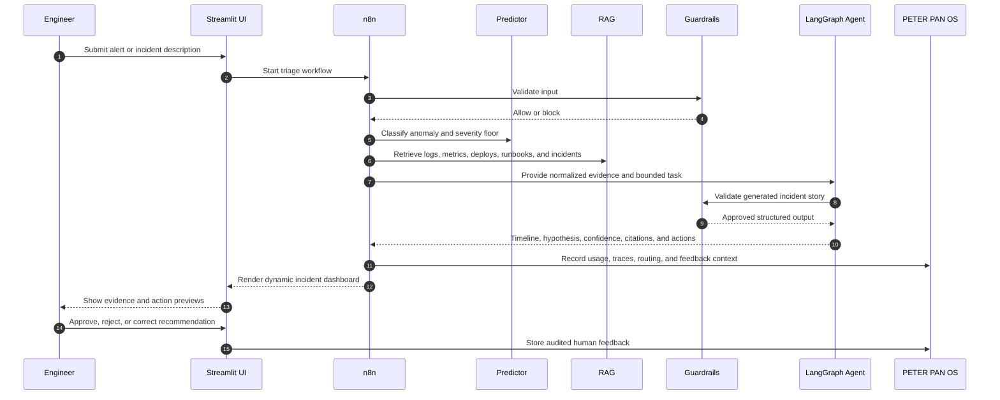

# Architecture

## Runtime flow (target)

## MVP mapping

In the MVP, n8n is replaced by in-process calls and each AI component is a
deterministic fixture behind the same interface. This is deliberate: the demo
path never depends on a live LLM (see CLAUDE.md golden rule 2). Swap order
when productionizing:

1. n8n webhook + flow between WebUI and services (contract already HTTP).
2. LangGraph agent replacing `build_story()` (same signature).
3. Vector store + Llama.cpp behind `search()`.
4. PyTorch classifier behind `predict()` — the keyword floor stays as the
   deterministic override.
5. NeMo Guardrails layered on the regex floors — floors keep final say.
6. Ollama-backed conversational sidebar in the WebUI.

## Environments

`PP_ENV` ∈ {mirage, staging, production}. Not deploy metadata — product
behavior: `Settings.actions_allowed` is False in production, which forces
every mutating ActionPreview through named human approval.

## Deployment (target)

Docker on AWS EC2, one container per service, ports 8001–8005; n8n (cloud or
self-hosted) reaches services over HTTP with security groups restricted to
the n8n egress IP and the developer IP — never 0.0.0.0/0. Secrets via env /
Secrets Manager only. Full local + AWS reference: [DEPLOYMENT.md](DEPLOYMENT.md).

## Incident processing flow

## Microservice grid and API mapping

| Service | Port | Core Technology | Primary Endpoints | Responsibility |
|---|---:|---|---|---|
| `predictor` | `8001` | PyTorch and deterministic keyword floors | `GET /healthz`, `POST /predict` | Classifies anomaly vectors and enforces minimum severity boundaries. |
| `rag` | `8002` | LangChain and AWS RDS for PostgreSQL with pgvector | `GET /healthz`, `POST /query` | Retrieves and aggregates codebase maps, logs, runbooks, deployment context, and historical incidents. |
| `guardrails` | `8003` | NeMo Guardrails and deterministic regular expressions | `GET /healthz`, `POST /check/input`, `POST /check/output` | Validates input patterns, output structure, and safety thresholds. |
| `agent` | `8004` | LangGraph stateful planner | `GET /healthz`, `POST /story` | Coordinates bounded tool-use, planning, evidence synthesis, and incident-story generation. |
| `PETER PAN OS` | `8005` | FastAPI and a thread-safe queue | `GET /healthz`, `GET /os/usage`, `GET /os/usage/series`, `GET /os/budget`, `GET /os/agents`, `GET /os/tips`, `GET /os/services` | Provides the operational control plane for cost, token, agent, routing, and usage visibility. The operator console rendering these feeds is the `web/agent-os` React app. |
