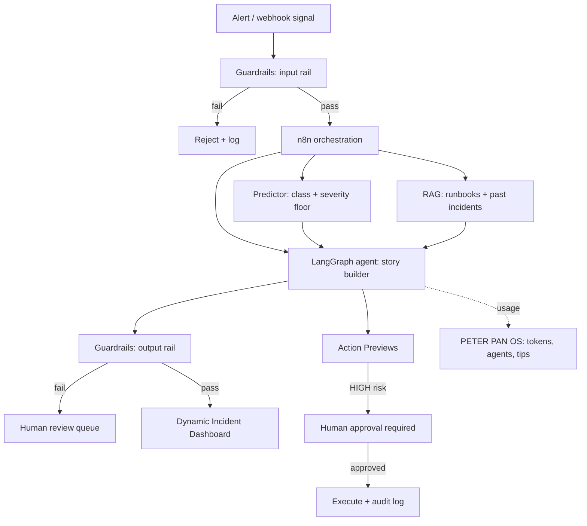

# Architecture

## Runtime flow (target)

## MVP mapping

In the MVP, n8n is replaced by in-process calls and each AI component is a
deterministic fixture behind the same interface. This is deliberate: the demo
path never depends on a live LLM (see CLAUDE.md golden rule 2). Swap order
when productionizing:

1. n8n webhook + flow between WebUI and services (contract already HTTP).
2. LangGraph agent replacing `build_story()` (same signature).
3. Vector store + Llama.cpp behind `search()`.
4. PyTorch classifier behind `predict()` — the keyword floor stays as the
   deterministic override.
5. NeMo Guardrails layered on the regex floors — floors keep final say.
6. Ollama-backed conversational sidebar in the WebUI.

## Environments

`PP_ENV` ∈ {mirage, staging, production}. Not deploy metadata — product
behavior: `Settings.actions_allowed` is False in production, which forces
every mutating ActionPreview through named human approval.

## Deployment (target)

Docker on AWS EC2, one container per service, ports 8001–8005; n8n (cloud or
self-hosted) reaches services over HTTP with security groups restricted to
the n8n egress IP and the developer IP — never 0.0.0.0/0. Secrets via env /
Secrets Manager only.
