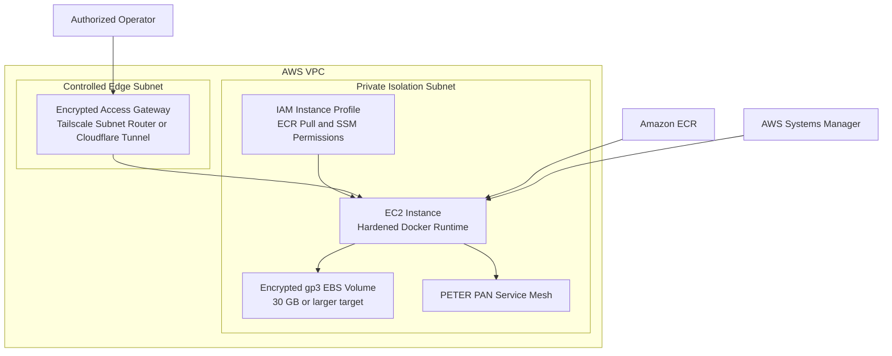

# Deployment

Full deployment reference — local stack and the hardened AWS target.
The quickstart lives in the top-level [README](../README.md).

## Local Deployment

### Prerequisites

- Python `3.12` or newer
- Docker Engine or Docker Desktop
- Docker Compose v2
- Git
- Sufficient local memory for the selected model and vector-store configuration

### 1. Clone the Repository

```bash
git clone https://github.com/reem-mor/peter-pan.git
cd peter-pan
```

### 2. Select the Safe Local Environment

Linux or macOS:

```bash
export PP_ENV=mirage
```

Windows PowerShell:

```powershell
$env:PP_ENV = "mirage"
```

### 3. Start the Service Mesh

```bash
docker compose up --build
```

This starts the core service mesh and its required dependencies according to the repository's Compose configuration.

#### Optional: real LLM synthesis through Compose

The agent service passes `PP_LLM` through (default `off` — fixture-first).
Any failure on either provider falls back to the deterministic story path.

Preferred: put the variables in the gitignored repo-root `.env` — Compose
interpolates it automatically and pydantic-settings reads the same file for
non-Docker runs, keeping keys out of your shell history. `export` works as
the ephemeral alternative:

```bash
# Direct Anthropic API
export PP_LLM=anthropic ANTHROPIC_API_KEY=sk-ant-...   # never commit keys
docker compose up --build

# AWS Bedrock (no Anthropic key; boto3 credential chain)
export PP_LLM=bedrock AWS_REGION=eu-west-1
export AWS_ACCESS_KEY_ID=... AWS_SECRET_ACCESS_KEY=... AWS_SESSION_TOKEN=...
docker compose up --build
```

PowerShell: `$env:PP_LLM = "bedrock"` etc. Override the model with
`PP_BEDROCK_MODEL_ID` (defaults to the known-good Sonnet id from
`src/peterpan/config.py`). Confirm the live path is actually taken by
checking for bedrock-model rows in the usage log (`/os/usage`); without
credentials the mesh stays healthy and stories are deterministic.

### 4. Start the Streamlit Interface

```bash
python -m streamlit run ui/app.py
```

Streamlit normally opens at:

```text
http://localhost:8501
```

### 5. Open the PETER PAN OS Operator Console (Agent OS)

```powershell
cd web\agent-os
npm install
npm run dev
```

Token/cost dashboard, agents, models, services, the daily budget guard, and
optimization tips — fed by the `log_usage` metering through the `/os/*` feeds
(the dev server proxies to `:8005`). Renders with demo data when the control
plane is unreachable (fixture-first).

### 6. Open the n8n Orchestration Panel

```text
http://localhost:5678
```

Use n8n to inspect the active JSON routing workflow between the user interface, control plane, and microservices.

### 7. Verify Service Health

```bash
curl http://localhost:8001/healthz
curl http://localhost:8002/healthz
curl http://localhost:8003/healthz
curl http://localhost:8004/healthz
curl http://localhost:8005/healthz
```

On Windows PowerShell, `Invoke-RestMethod` can be used instead:

```powershell
Invoke-RestMethod http://localhost:8001/healthz
Invoke-RestMethod http://localhost:8002/healthz
Invoke-RestMethod http://localhost:8003/healthz
Invoke-RestMethod http://localhost:8004/healthz
Invoke-RestMethod http://localhost:8005/healthz
```

### Stop the Stack

```bash
docker compose down
```

To remove local volumes as well:

```bash
docker compose down -v
```

Use the volume-removal command only when you intentionally want to delete local persisted data.

## Enterprise AWS Deployment Target

PETER PAN is designed to support a hardened AWS deployment through infrastructure definitions in `infra/aws/`, including AWS CloudFormation.



### Network Perimeter Hardening

- Compute workloads run inside a private subnet.
- Unrestricted inbound rules such as `0.0.0.0/0` are prohibited.
- Administrative access is brokered through an encrypted Tailscale subnet router, Cloudflare Tunnel, or another explicitly approved private-access mechanism.
- Direct public exposure of internal service ports is not part of the target architecture.

### AWS IAM Least Privilege

- EC2 uses an IAM instance profile rather than long-lived static credentials.
- ECR permissions are limited to the actions required to pull approved images.
- SSM permissions are scoped to controlled instance management.
- AWS mutation permissions are separated from normal read-only incident analysis.
- Every allowed API action should be traceable to a specific IAM policy statement.

### Storage Baseline

- Use encrypted `gp3` EBS volumes.
- A baseline of at least `30 GB` is recommended for container layers, logs, vector data, and local caches.
- Application data, logs, and vector-store data should be isolated from disposable container layers where practical.
