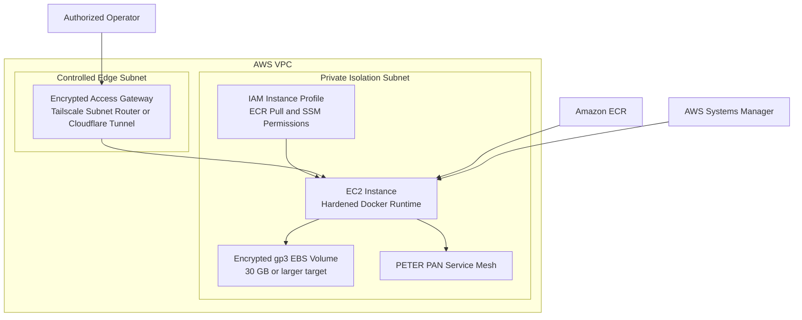

# Deployment

Full deployment reference — local stack and the hardened AWS target.
The quickstart lives in the top-level [README](../README.md).

## Local Deployment

### Prerequisites

- Python `3.12` or newer
- Docker Engine or Docker Desktop
- Docker Compose v2
- Git
- Sufficient local memory for the selected model and vector-store configuration

### 1. Clone the Repository

```bash
git clone https://github.com/reem-mor/peter-pan.git
cd peter-pan
```

### 2. Select the Safe Local Environment

Linux or macOS:

```bash
export PP_ENV=mirage
```

Windows PowerShell:

```powershell
$env:PP_ENV = "mirage"
```

### 3. Start the Service Mesh

```bash
docker compose up --build
```

This starts the core service mesh and its required dependencies according to the repository's Compose configuration.

#### Optional: real LLM synthesis through Compose

The agent service passes `PP_LLM` through (default `off` — fixture-first).
Any failure on either provider falls back to the deterministic story path.

Preferred: put the variables in the gitignored repo-root `.env` — Compose
interpolates it automatically and pydantic-settings reads the same file for
non-Docker runs, keeping keys out of your shell history. `export` works as
the ephemeral alternative:

```bash
# Direct Anthropic API
export PP_LLM=anthropic ANTHROPIC_API_KEY=sk-ant-...   # never commit keys
docker compose up --build

# AWS Bedrock (no Anthropic key; boto3 credential chain)
export PP_LLM=bedrock AWS_REGION=eu-west-1
export AWS_ACCESS_KEY_ID=... AWS_SECRET_ACCESS_KEY=... AWS_SESSION_TOKEN=...
docker compose up --build
```

PowerShell: `$env:PP_LLM = "bedrock"` etc. Override the model with
`PP_BEDROCK_MODEL_ID` (defaults to the known-good Sonnet id from
`src/peterpan/config.py`). Confirm the live path is actually taken by
checking for bedrock-model rows in the usage log (`/os/usage`); without
credentials the mesh stays healthy and stories are deterministic.

### 4. Start the Streamlit Interface

```bash
python -m streamlit run ui/app.py
```

Streamlit normally opens at:

```text
http://localhost:8501
```

### 5. Open the PETER PAN OS Operator Console (Agent OS)

```powershell
cd web\agent-os
npm install
npm run dev
```

Token/cost dashboard, agents, models, services, the daily budget guard, and
optimization tips — fed by the `log_usage` metering through the `/os/*` feeds
(the dev server proxies to `:8005`). Renders with demo data when the control
plane is unreachable (fixture-first).

### 6. Open the n8n Orchestration Panel

```text
http://localhost:5678
```

Use n8n to inspect the active JSON routing workflow between the user interface, control plane, and microservices.

### 7. Verify Service Health

```bash
curl http://localhost:8001/healthz
curl http://localhost:8002/healthz
curl http://localhost:8003/healthz
curl http://localhost:8004/healthz
curl http://localhost:8005/healthz
```

On Windows PowerShell, `Invoke-RestMethod` can be used instead:

```powershell
Invoke-RestMethod http://localhost:8001/healthz
Invoke-RestMethod http://localhost:8002/healthz
Invoke-RestMethod http://localhost:8003/healthz
Invoke-RestMethod http://localhost:8004/healthz
Invoke-RestMethod http://localhost:8005/healthz
```

### Stop the Stack

```bash
docker compose down
```

To remove local volumes as well:

```bash
docker compose down -v
```

Use the volume-removal command only when you intentionally want to delete local persisted data.

## Shipped Demo Stack (`infra/aws/stack.yaml`)

What actually deploys today: one EC2 instance running the five services from
ECR, SSM-only access (no SSH), service ports allowlisted to two `/32` CIDRs.
Delete the stack to tear everything down.

| Parameter | Meaning |
|---|---|
| `DevIp`, `N8nIp` | The only two CIDRs allowed to reach ports 8001–8005 |
| `ImageUri` | ECR image (`repo:tag`) all five services run |
| `SecretArn` | Secrets Manager JSON with `ANTHROPIC_API_KEY`, `PINECONE_API_KEY`, `VOYAGE_API_KEY` — created by `scripts/put_deploy_secret.py`. `ANTHROPIC_API_KEY` may be empty when `LlmProvider=bedrock` |
| `LlmProvider` | `off` \| `anthropic` \| `bedrock` — becomes `PP_LLM` on the agent container |
| `BedrockModelId` | Always injected as `PP_BEDROCK_MODEL_ID` on the agent container; only consulted when `LlmProvider=bedrock` |
| `RagBackend` | `lexical` \| `pinecone` — becomes `PP_RAG_BACKEND` on the rag container |

### Bedrock mode (`LlmProvider=bedrock`)

- **No API key.** The agent container authorizes through the EC2 instance
  profile; the stack grants `bedrock:InvokeModel` (+ `InvokeModelWithResponseStream`)
  on the inference-profile ARN for `BedrockModelId` and on the Claude 4.5
  foundation-model ARNs in `us-east-1` / `us-east-2` / `us-west-2` (required
  by the default `us.anthropic....` cross-region profile).
- **Region + model id** are injected into the agent container (`AWS_REGION`,
  `PP_BEDROCK_MODEL_ID`); credentials resolve via IMDSv2 — the instance sets
  `HttpTokens: required` and `HttpPutResponseHopLimit: 2` (bridge-networked
  containers cannot reach IMDS at the default hop limit of 1).
- **Default model id** is the cross-region inference profile
  `us.anthropic.claude-sonnet-4-5-20250929-v1:0`. On-demand foundation-model
  ids for Claude 4.5 raise `ValidationException` — do not use them.
- **Day-2 image updates:** prefer `python scripts/deploy_ec2_rolling.py`
  (SSM recreate). Changing `ImageUri` / `LlmProvider` via CloudFormation
  rewrites `UserData` and **replaces the instance**.
- The agent service runs retrieval **in-process** — rolling/UserData must
  pass `PP_RAG_BACKEND` + Pinecone/Voyage keys to **agent** as well as rag.
- Rolling deploy seeds `/opt/peterpan/knowledge` from the image and runs
  `scripts/ingest_kb.py` (idempotent upsert) so Pinecone is never empty.
- Any Bedrock failure (permissions, region, model access, schema) degrades
  to the deterministic story path — check `providers.llm` /
  `providers.llm_fallback` on `/story` and `usage.jsonl` for live metering.

State on the instance: `/opt/peterpan/usage` (shared metering log),
`/opt/peterpan/agent-data` (prompt log), `/opt/peterpan/ppos-data`
(feedback + leads) — per-service mounts, surviving container recreation.

Observability (demo ops):
- Log group `/peter-pan/demo` — container stdout/stderr via the `awslogs` driver
- Alarms `peter-pan-demo-status-check-failed`, `peter-pan-demo-cpu-high`
- Stack outputs include `InstanceId`, `SecurityGroupId`, `LogGroupName`

### Day-2 parameter hygiene

| Drift | Fix |
|---|---|
| Your egress IP ∉ `DevIp` | Re-resolve `https://checkip.amazonaws.com`, then `aws cloudformation update-stack … ParameterKey=DevIp,ParameterValue=<ip>/32` (keep other params). Mesh ports 8001–8005 are `/32`-exact. If the SG was patched out-of-band, also sync the CFN parameter so the next template update does not revert the CIDR. |
| `LlmProvider=anthropic` on a Bedrock-ready host | Set `LlmProvider=bedrock` (template default). **UserData change replaces the instance.** |
| Stale `ImageUri` tag | Prefer `python scripts/deploy_ec2_rolling.py` (SSM recreate; resolves `InstanceId` from stack output, with tag fallback). Avoid CFN `ImageUri` updates unless you intend replacement. |
| Root volume unencrypted / undersized | Shipped template forces encrypted gp3 30 GB. Applying that template to an older stack **replaces** the instance (in-place encrypt is not supported). Use `scripts/sync_demo_stack.py` to preview via change-set before execute. |
| Local compose returns 401 with a deploy `.env` | Compose reads `PP_COMPOSE_API_TOKEN`, not `PP_API_TOKEN`. Leave unset for the open fixture mesh. |

### AgentCore / Bedrock KB (not required for Pinecone path)

- Demo agent runs `PP_AGENT_PROVIDER=local`. Empty AgentCore runtime list is expected.
- Correct control-plane list op: `aws bedrock-agentcore-control list-agent-runtimes --region us-east-1` (not `bedrock-agentcore list-runtimes`).
- Retrieval is Pinecone (`RagBackend=pinecone`). Unrelated Bedrock Knowledge Bases in the account are out of scope — do not treat them as PETER PAN resources.

### Post-update verification (P4 checklist)

```powershell
$egress = (Invoke-RestMethod https://checkip.amazonaws.com).Trim()
aws cloudformation describe-stacks --stack-name peter-pan-demo --region us-east-1 `
  --query "Stacks[0].{Status:StackStatus,Params:Parameters}" --output table
# DevIp must equal "$egress/32"; LlmProvider should be bedrock; ImageUri tag ≈ git HEAD
# Param-only DevIp sync (needs IAM capability even with --use-previous-template):
# aws cloudformation update-stack --stack-name peter-pan-demo --region us-east-1 `
#   --use-previous-template --capabilities CAPABILITY_NAMED_IAM `
#   --parameters ParameterKey=DevIp,ParameterValue=$egress/32 `
#   ParameterKey=N8nIp,UsePreviousValue=true ParameterKey=ImageUri,UsePreviousValue=true `
#   ParameterKey=SecretArn,UsePreviousValue=true ParameterKey=LlmProvider,UsePreviousValue=true `
#   ParameterKey=RagBackend,UsePreviousValue=true ParameterKey=InstanceType,UsePreviousValue=true `
#   ParameterKey=AmiId,UsePreviousValue=true
# Full template sync (encrypted root / bedrock / outputs) — preview then execute:
#   python scripts/sync_demo_stack.py
#   python scripts/sync_demo_stack.py --execute
$iid = aws cloudformation describe-stacks --stack-name peter-pan-demo --region us-east-1 `
  --query "Stacks[0].Outputs[?OutputKey=='InstanceId'].OutputValue" --output text
if (-not $iid) {
  $iid = aws ec2 describe-instances --region us-east-1 `
    --filters Name=tag:Name,Values=peter-pan-demo Name=instance-state-name,Values=running `
    --query "Reservations[0].Instances[0].InstanceId" --output text
}
aws ec2 describe-instances --instance-ids $iid --region us-east-1 `
  --query "Reservations[0].Instances[0].{State:State.Name,HttpTokens:MetadataOptions.HttpTokens,Vol:BlockDeviceMappings[0].Ebs.VolumeId}"
$vol = aws ec2 describe-instances --instance-ids $iid --region us-east-1 `
  --query "Reservations[0].Instances[0].BlockDeviceMappings[0].Ebs.VolumeId" --output text
aws ec2 describe-volumes --volume-ids $vol --region us-east-1 --query "Volumes[0].Encrypted"
# Encrypted must be true on the attached root volume
aws logs describe-log-groups --log-group-name-prefix /peter-pan --region us-east-1
aws cloudwatch describe-alarms --alarm-name-prefix peter-pan --region us-east-1 `
  --query "MetricAlarms[].AlarmName"
$pip = aws cloudformation describe-stacks --stack-name peter-pan-demo --region us-east-1 `
  --query "Stacks[0].Outputs[?OutputKey=='PublicIp'].OutputValue" --output text
1..5 | ForEach-Object { Invoke-RestMethod "http://${pip}:800$_/healthz" }
```

## Enterprise AWS Deployment Target

The hardened target architecture below is the direction of travel — the
shipped demo stack above intentionally trades a private subnet + tunnel for
allowlisted public ports. PETER PAN is designed to support a hardened AWS
deployment through infrastructure definitions in `infra/aws/`, including AWS
CloudFormation.



### Network Perimeter Hardening

- Compute workloads run inside a private subnet.
- Unrestricted inbound rules such as `0.0.0.0/0` are prohibited.
- Administrative access is brokered through an encrypted Tailscale subnet router, Cloudflare Tunnel, or another explicitly approved private-access mechanism.
- Direct public exposure of internal service ports is not part of the target architecture.

### AWS IAM Least Privilege

- EC2 uses an IAM instance profile rather than long-lived static credentials.
- ECR permissions are limited to the actions required to pull approved images.
- SSM permissions are scoped to controlled instance management.
- AWS mutation permissions are separated from normal read-only incident analysis.
- Every allowed API action should be traceable to a specific IAM policy statement.

### Storage Baseline

- Use encrypted `gp3` EBS volumes.
- A baseline of at least `30 GB` is recommended for container layers, logs, vector data, and local caches.
- Application data, logs, and vector-store data should be isolated from disposable container layers where practical.
