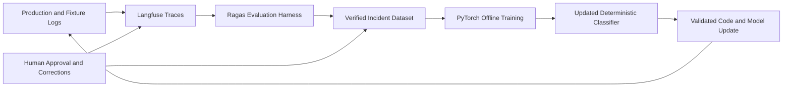

# Monitoring, Evaluation, and Learning Loop

PETER PAN implements a closed-loop LLMOps lifecycle across three operational layers:

1. Observability and trace collection
2. Automated retrieval and generation evaluation
3. Offline classifier improvement

## 1. Real-Time Observability and Production Monitoring with Langfuse

Agent steps, tool invocations, prompt versions, model calls, and retrieval chunks are traced through an asynchronous and non-blocking observability path.

- **Trace analytics:** LangGraph execution steps are recorded as linked spans so routing bottlenecks, latency, tool failures, and context growth can be investigated. Configured anomaly and latency thresholds can alert the platform engineering team.
- **Cost and token attribution:** Commercial and local-model usage can be attributed to a specific incident, workflow, agent, and service.
- **Human feedback capture:** Approval, rejection, and correction events from the Action Preview Gate are attached to the relevant trace identifier.
- **Operational dataset creation:** Verified feedback creates higher-quality examples for later evaluation and offline learning.

## 2. Automated Regression and Quality Evaluation with Ragas

Prompt changes, retrieval changes, and agent-logic changes are evaluated with software-engineering discipline through a headless Ragas harness. Changes to versioned prompts or the RAG ingestion path can trigger this regression suite automatically in CI/CD.

- **Faithfulness:** Checks whether generated incident conclusions remain grounded in retrieved metrics, logs, and operational evidence.
- **Answer relevance:** Checks whether remediation options directly address the observed incident rather than adding irrelevant text.
- **Context recall:** Measures whether the retriever finds the runbooks, configurations, deployment diffs, and historical incidents needed to answer correctly.
- **Context precision:** Measures whether retrieved evidence is relevant instead of introducing unnecessary context.

## 3. PyTorch Deterministic Classifier Floor

The `predictor` service on port `8001` runs a lightweight local PyTorch classifier.

- **The guard:** It evaluates incoming alert signals and establishes a minimum mathematical severity level, such as Severity 1 through Severity 4.
- **The override:** Deterministic severity rules can raise the minimum result when critical patterns are detected.
- **The learning loop:** Verified incidents and human corrections can be exported into an offline training pipeline. Candidate classifier updates are evaluated before validated versions are deployed back into the service.
- **The cost benefit:** Better local classification reduces unnecessary dependence on commercial models for basic routing and severity decisions.
